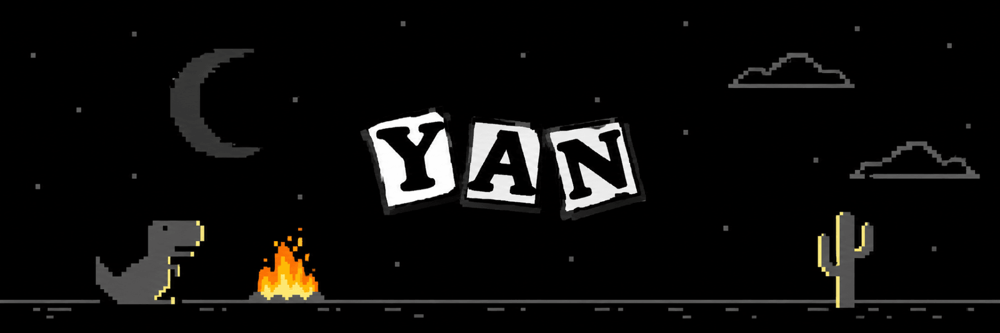
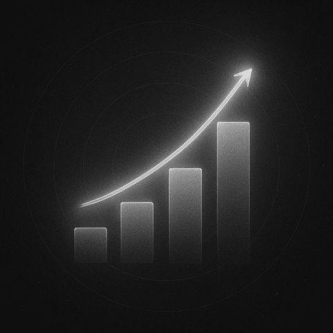

<!--
  YAN PIETRO — GITHUB PROFILE README
  Repository: https://github.com/Yanpi1/Yanpi1
  Keep the assets/ folder next to this README.md so the images load correctly.
-->

  

<h1 align="center">Yan Pietro</h1>

  <strong>Systems Developer</strong> &nbsp;•&nbsp; <strong>Web Designer</strong> &nbsp;•&nbsp; <strong>Front-End Developer</strong>

  
  
  
  

  <a href="https://github.com/Yanpi1"><strong>GitHub Profile</strong></a>
  &nbsp;•&nbsp;
  <a href="https://github.com/Yanpi1?tab=repositories"><strong>Repositories</strong></a>

---

<table>
  <tr>
    <td width="65%" valign="top">
      <h3>01 / About Me</h3>
      

        I am a <strong>systems developer and web designer</strong> driven by the intersection of
        technology, creativity, and user experience.
      

      

        My goal is to transform ideas into <strong>modern, functional, and visually impactful digital experiences</strong>,
        combining software development, design thinking, and intuitive interfaces.
      

      

        I enjoy working across the stack — from designing clean interfaces and interactions
        to building the logic and systems behind them.
      

      

        
        
        
      

    </td>
    <td width="35%" align="center" valign="middle">
      
    </td>
  </tr>
</table>

<h3 align="center">02 / Languages &amp; Technologies</h3>

  

<table>
  <tr>
    <td width="18%"><strong>Languages</strong></td>
    <td>HTML5, CSS3, JavaScript, TypeScript</td>
  </tr>
  <tr>
    <td><strong>Front-End</strong></td>
    <td>React, Tailwind CSS, responsive development</td>
  </tr>
  <tr>
    <td><strong>Back-End</strong></td>
    <td>Node.js, REST APIs</td>
  </tr>
  <tr>
    <td><strong>Mobile</strong></td>
    <td>React Native</td>
  </tr>
  <tr>
    <td><strong>Database</strong></td>
    <td>Supabase</td>
  </tr>
  <tr>
    <td><strong>Workflow</strong></td>
    <td>Git, GitHub, VS Code, pnpm</td>
  </tr>
  <tr>
    <td><strong>Design</strong></td>
    <td>Web Design, UI Design, UX Design, prototyping, interface creation</td>
  </tr>
</table>

<h3 align="center">03 / What I Do</h3>

<table>
  <tr>
    <td width="50%" valign="top">
      <strong>Web Design</strong> 
      Creating modern, responsive, and professional interfaces.
    </td>
    <td width="50%" valign="top">
      <strong>Front-End Development</strong> 
      Building interactive and responsive web applications.
    </td>
  </tr>
  <tr>
    <td valign="top">
      <strong>Back-End Development</strong> 
      Developing systems, APIs, and database integrations.
    </td>
    <td valign="top">
      <strong>UI / UX Design</strong> 
      Designing intuitive interfaces and user-centered experiences.
    </td>
  </tr>
  <tr>
    <td valign="top">
      <strong>Mobile Development</strong> 
      Creating applications for mobile devices.
    </td>
    <td valign="top">
      <strong>Full-Stack Development</strong> 
      Connecting front-end experiences with back-end logic.
    </td>
  </tr>
  <tr>
    <td valign="top">
      <strong>Automation</strong> 
      Building solutions that optimize everyday processes.
    </td>
    <td valign="top">
      <strong>AI-Assisted Development</strong> 
      Using artificial intelligence to support development workflows.
    </td>
  </tr>
</table>

<h3 align="center">04 / Selected Projects</h3>

<table>
  <tr>
    <td width="50%" valign="top">
      <h4>01 — ASCEND</h4>
      

        A full-stack project with <strong>web and mobile applications</strong>,
        integrating interfaces, features, and back-end services.
      

      

        
        
        
      

    </td>
    <td width="50%" valign="top">
      <h4>02 — Capta Imóveis</h4>
      

        A system focused on <strong>real-estate information management</strong>,
        data organization, and process automation.
      

      

        
        
        
      

    </td>
  </tr>
</table>

  <a href="https://github.com/Yanpi1?tab=repositories"><strong>Explore my repositories ↗</strong></a>

---

<table>
  <tr>
    <td width="34%" valign="middle" align="center">
      
    </td>
    <td width="66%" valign="middle">
      <h3>05 / Professional Goals</h3>
      <ul>
        <li>Develop innovative digital experiences.</li>
        <li>Improve my full-stack development skills.</li>
        <li>Create interfaces with high visual quality.</li>
        <li>Explore emerging technologies and AI-powered tools.</li>
        <li>Build scalable, efficient, and intuitive solutions.</li>
      </ul>
    </td>
  </tr>
</table>

  <h3>Let’s build something meaningful.</h3>
  
Design with intention. Develop with purpose. Keep improving.

  

    <a href="https://github.com/Yanpi1"><strong>github.com/Yanpi1</strong></a>
    &nbsp;•&nbsp; Brazil
  

