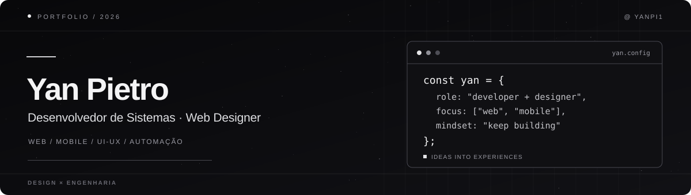
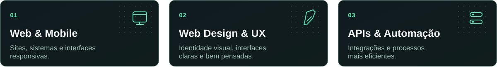
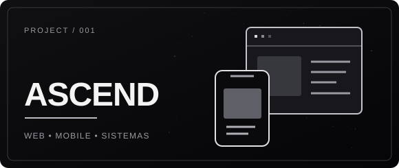
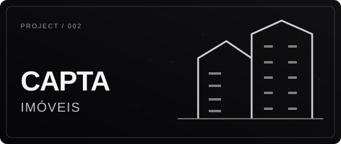
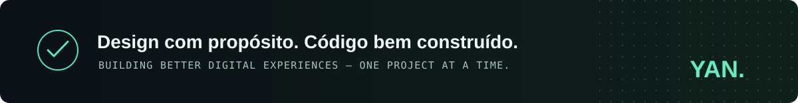

  

   

  
  
  
  

  
<strong>Unindo desenvolvimento, design e tecnologia para transformar ideias em experiências digitais.</strong>

  

    <a href="https://github.com/Yanpi1?tab=repositories">Explorar meus repositórios ↗</a>
    &nbsp; · &nbsp;
    <a href="https://github.com/Yanpi1">Meu perfil no GitHub ↗</a>
  

 

## `01.` Sobre mim

<table>
  <tr>
    <td width="63%" valign="top">
      <h3>Olá, eu sou o Yan! 👋</h3>
      
Sou <strong>desenvolvedor de sistemas e Web Designer</strong>, interessado em criar soluções que combinam <strong>funcionalidade, estética e uma boa experiência de uso</strong>.

      
Gosto de participar da construção de um projeto como um todo: da organização do código à interface com a qual as pessoas interagem.

      
Meu foco está em <strong>desenvolvimento web e mobile</strong>, <strong>UI/UX</strong>, integração de <strong>APIs</strong> e <strong>automação</strong>. Estou sempre explorando novas ferramentas e refinando a maneira como desenvolvo.

    </td>
    <td width="37%" valign="top">
      <pre lang="js"><code>const yan = {
  work: "dev + design",
  focus: [
    "web", "mobile",
    "ui/ux", "apis"
  ],
  mindset: "evolve"
};</code></pre>
    </td>
  </tr>
</table>

 

## `02.` O que eu faço

 

## `03.` Tecnologias

  
TECNOLOGIAS E FERRAMENTAS QUE FAZEM PARTE DO MEU UNIVERSO

  

    
  

  

    
    
    
    
  

 

## `04.` Projetos em destaque

<table>
  <tr>
    <td width="50%" valign="top">
      
      <h3>ASCEND</h3>
      
Aplicação de loja com foco em <strong>experiência do usuário</strong>, integração entre <strong>front-end e back-end</strong> e adaptação para dispositivos móveis.

      
<code>Web</code> <code>Mobile</code> <code>Interfaces</code>

      <a href="https://github.com/Nate-Allen21/FRONTEND-ASCEND"><strong>Explorar o front-end ↗</strong></a>
    </td>
    <td width="50%" valign="top">
      
      <h3>Capta Imóveis</h3>
      
Sistema voltado à <strong>organização de captações imobiliárias</strong>, centralização de informações e exploração de automações de pesquisa e cadastro.

      
<code>Sistemas</code> <code>Dados</code> <code>Automação</code>

      <strong>Desenvolvimento de soluções e processos</strong>
    </td>
  </tr>
</table>

  

 

## `05.` Atividade no GitHub

  
  

  
   
  Os indicadores acima são fornecidos por serviços externos e consideram dados públicos do GitHub.

 

## `06.` Vamos construir algo interessante?

Tenho interesse em projetos que valorizam uma **boa experiência de usuário**, **código organizado** e **soluções úteis**. Seja construindo interfaces, desenvolvendo sistemas ou explorando novas tecnologias, meu objetivo é seguir evoluindo a cada entrega.

  
    
  
   
  Feito com atenção aos detalhes por <a href="https://github.com/Yanpi1">Yan</a>.

