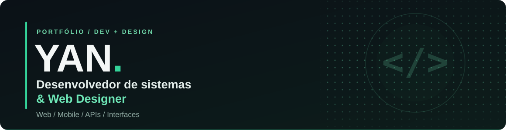

  

  

    <a href="https://github.com/Yanpi1?tab=repositories">Explorar meus repositórios ↗</a>
  

## Sobre mim

Olá! Sou **Yan**, **desenvolvedor de sistemas e Web Designer**. Gosto de criar soluções digitais que combinam funcionalidade, design e uma boa experiência para quem usa.

Tenho interesse em desenvolvimento **web e mobile**, integração de **APIs** e **automação**, sempre buscando interfaces claras e código bem organizado.

## O que eu faço

- **Web e mobile** — sites, sistemas e interfaces responsivas.
- **Web design e UI/UX** — layouts modernos, intuitivos e com atenção aos detalhes.
- **APIs e automação** — integrações que conectam serviços e simplificam processos.

## Tecnologias

`JavaScript` · `HTML5` · `CSS3` · `React` · `React Native` · `Node.js` · `Supabase` · `Git`

## Projetos em desenvolvimento

**ASCEND**  
Aplicação para loja com foco em interface, integração entre front-end e back-end e experiência em diferentes dispositivos.

**Capta Imóveis**  
Sistema para organizar informações de captação imobiliária e explorar automações de pesquisa e cadastro.

---

  Construindo, aprendendo e melhorando a cada projeto.
  
<a href="https://github.com/Yanpi1?tab=repositories"><strong>Ver projetos no GitHub →</strong></a>

