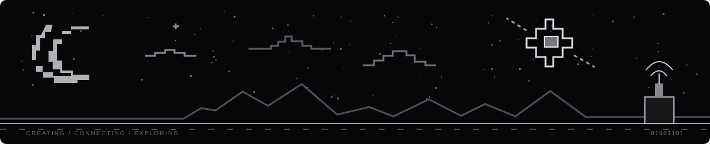

  
   
   
  <a href="#sobre-mim">Sobre mim</a> &nbsp;·&nbsp;
  <a href="#o-que-eu-faco">Áreas</a> &nbsp;·&nbsp;
  <a href="#tecnologias">Tecnologias</a> &nbsp;·&nbsp;
  <a href="#projetos">Projetos</a> &nbsp;·&nbsp;
  <a href="#atividade">Atividade</a>

 

## Sobre mim

**Olá, eu sou o Yan.** Desenvolvedor de sistemas e Web Designer, apaixonado por construir experiências digitais que unem **design, funcionalidade e código bem estruturado**.

Meu foco é desenvolvimento **web e mobile**, criação de interfaces **UI/UX**, integração de **APIs** e **automação**. Gosto de cuidar tanto dos detalhes visuais quanto da lógica que faz tudo funcionar.

  

 

## O que eu faço

 

## Tecnologias

  TECNOLOGIAS E FERRAMENTAS
    
  
  
  
  
  
  
  
  
  
  

 

## Projetos

<table>
  <tr>
    <td width="50%" valign="top">
      
      <h3>ASCEND</h3>
      
Projeto de plataforma de loja, com desenvolvimento de interfaces, integração entre front-end e back-end e experiência mobile.

      <strong>Web · Mobile · Sistemas</strong>
        
      <a href="https://github.com/Nate-Allen21/FRONTEND-ASCEND">Front-end ↗</a> &nbsp;·&nbsp;
      <a href="https://github.com/Nate-Allen21/BACKEND-ASCEND">Back-end ↗</a> &nbsp;·&nbsp;
      <a href="https://github.com/Nate-Allen21/ASCEND-mobile">Mobile ↗</a>
    </td>
    <td width="50%" valign="top">
      
      <h3>Capta Imóveis</h3>
      
Sistema voltado à organização de captações imobiliárias, centralização de informações e automação de processos.

      <strong>Sistemas · Dados · Automação</strong>
    </td>
  </tr>
</table>

  <a href="https://github.com/Yanpi1?tab=repositories"><strong>Ver todos os meus repositórios ↗</strong></a>

 

## Atividade

  
  
   
  

Os gráficos são carregados por serviços externos e podem ficar indisponíveis temporariamente.

 

## Contato

Curte desenvolvimento, design ou tem uma ideia de projeto? Vamos conversar.

  

  
  Design com propósito. Código em constante evolução.

